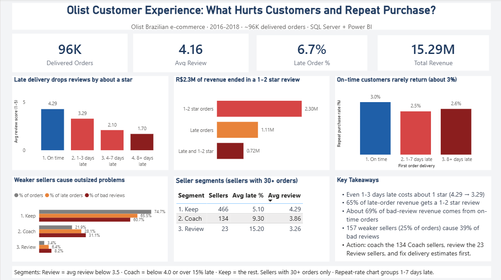

# Olist Customer Experience Analysis

**What hurts customers and repeat purchases in a Brazilian e-commerce marketplace?**
An end-to-end analysis of ~96K delivered orders using **SQL Server (T-SQL)** and **Power BI**.



---

## Business problem

Only about **3%** of Olist customers buy again. This project asks:

1. Does late delivery hurt reviews, and at what point?
2. Which sellers cause a disproportionate share of problems?
3. Does a bad first delivery reduce repeat purchases?
4. How much revenue is linked to bad experiences?

## Key findings

| # | Finding | Evidence |
|---|---------|----------|
| 1 | **Late delivery is associated with much lower reviews, even for short delays** | On-time orders average **4.29** stars. 1-3 days late: **3.29**. 4-7 days late: **2.10**. 8+ days late: **1.70**. |
| 2 | **Revenue is linked to bad experiences** | Of R$15.29M total revenue, R$1.11M (7.3%) came from late orders and R$2.30M (15.1%) from 1-2 star orders. About 65% of late-order revenue received a 1-2 star review. |
| 3 | **Lateness is not the whole story** | About 69% of 1-2 star revenue came from on-time orders, so product and service quality also matter. |
| 4 | **Repeat purchase is low everywhere** | Repeat rate is **3.01%** after an on-time first order, 2.48% after a 1-7 day delay, and 2.62% after 8+ days late. A late first delivery lowers it only slightly. |
| 5 | **A small group of sellers causes outsized problems** | The 157 sellers in the Coach and Review segments handle 25.3% of orders but account for 39.3% of bad reviews. The 23 Review sellers have a 15.2% average late rate versus 5.1% for Keep sellers. |

## Recommendations

1. **Target weaker sellers first.** Start a coaching programme for the 134 "Coach" sellers and a performance review for the 23 "Review" sellers.
2. **Fix delivery estimates and late orders.** Even a 1-3 day delay costs about one star.
3. **Investigate on-time bad reviews.** Most unhappy customers received their order on time, so check product quality and listing accuracy by category.
4. **Treat retention separately.** With about 3% repeat purchase even after good deliveries, test follow-up offers and re-engagement, because delivery fixes alone will not bring customers back.

## Seller segments

| Segment | Rule | Sellers | Avg late % | Avg review |
|---------|------|---------|-----------|------------|
| Keep | Avg review 4.0 or higher and late rate 15% or lower | 466 | 5.1% | 4.29 |
| Coach | Avg review below 4.0, or late rate above 15% | 134 | 9.3% | 3.86 |
| Review | Avg review below 3.5 | 23 | 15.2% | 3.26 |

Only sellers with **30+ orders** are included (623 sellers).

## Data quality decisions

- Analysed **delivered orders only**. Cancelled and unfinished orders have no delivery date.
- Kept the **latest review per order** (`ROW_NUMBER()`), because some orders have several reviews and would otherwise be counted twice.
- Used `customer_unique_id` for repeat purchases, because `customer_id` changes with every order.
- Excluded sellers with fewer than 30 orders, so a few orders cannot distort a seller's average.
- Fixed a header row that was imported as data in `category_translation`.
- Revenue is `price + freight_value` per order. All revenue figures are in Brazilian reais (R$).

## Tools and techniques

- **SQL Server (T-SQL):** joins, CTEs, window functions (`ROW_NUMBER`, `SUM() OVER`), views, `CASE` segmentation, aggregation
- **Power BI:** KPI cards, bar and column charts, tables, custom measures, one-page layout
- **Git and GitHub:** version control, one query file per question

## Repository structure

```
├── SQL/
│   ├── 00_create_view.sql              # delivered_orders view (latest review per order)
│   ├── 01_delivery_vs_reviews.sql      # review score by delivery delay bucket
│   ├── 02_seller_scorecard.sql         # orders, revenue, late %, review per seller
│   ├── 03_seller_segments.sql          # Keep / Coach / Review segmentation
│   ├── 04_repeat_purchase.sql          # repeat rate by first-order delivery
│   ├── 05_revenue_at_risk.sql          # revenue linked to late and bad-review orders
│   └── 06_problem_concentration.sql    # share of problems by seller segment
├── dashboard/
│   ├── dashboard.png                   # dashboard screenshot
│   └── Olist_Dashboard.pbix            # Power BI file
└── README.md
```

## How to reproduce

1. Download the [Brazilian E-Commerce Public Dataset by Olist](https://www.kaggle.com/datasets/olistbr/brazilian-ecommerce) from Kaggle. Raw data is not included in this repo.
2. In SQL Server Management Studio, create a database named `Olist` and import the CSVs with **Tasks → Import Flat File**, using the table names `customers`, `orders`, `order_items`, `reviews`, `payments`, `products`, `sellers`, and `category_translation`.
3. Run the queries in `SQL/` in numeric order, starting with `00_create_view.sql`.
4. Open `dashboard/Olist_Dashboard.pbix` in Power BI Desktop and refresh it against your local `Olist` database.

## Limitations

- These findings show **association, not proof of cause**. Late orders may also have other problems.
- Repeat purchase counts only later orders that were delivered and reviewed.
- Seller segment thresholds (3.5, 4.0, 15%) are simple judgement calls, not statistical cut-offs.
- Dataset covers 2016-2018 and one marketplace, so results may not generalise.

## Author

**Mohammed Ali Shaik**, aspiring Data Analyst
[LinkedIn](https://linkedin.com/in/ali-shaik-data-analyst) · [GitHub](https://github.com/shaikali0519) · shaikali0519@gmail.com
